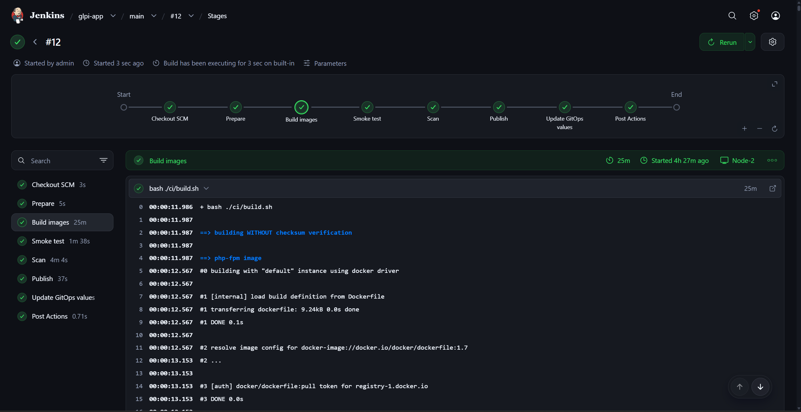

# GLPI 12 CI/CD Pipeline

Jenkins pipeline for building, validating, scanning, and publishing GLPI 12 PHP-FPM and nginx container images. Published images are pinned by digest in the GitOps repository so Argo CD can deploy a specific, immutable build.

## Pipeline

1. Check out the `main` branch and verify the build tools and upstream GLPI version.
2. Build the PHP-FPM and nginx images.
3. Run the smoke test against a temporary MariaDB stack.
4. Scan both images with Trivy for fixable HIGH and CRITICAL vulnerabilities.
5. Publish the images and record their registry digests.
6. Commit the digest updates to [`glpi-gitops-cicd`](https://github.com/MohamedBakrim/glpi-gitops-cicd).
7. Argo CD monitors that GitOps repository; with automated sync enabled, it applies the new values and reconciles the Kubernetes deployment.

Jenkins updates Git; Argo CD applies the GitOps state to the cluster. Jenkins does not connect directly to Kubernetes.

## Successful Jenkins run

Build **#12** on `main` completed successfully. All pipeline stages passed, including the Trivy scan, image publish, and GitOps values update.

## Repositories and live portfolio

- [Application and CI/CD pipeline](https://github.com/MohamedBakrim/glpi-app-cicd)
- [Helm chart](https://github.com/MohamedBakrim/glpi-chart-cicd)
- [GitOps values and Argo CD application](https://github.com/MohamedBakrim/glpi-gitops-cicd)
- [Portfolio](https://medbak.xyz/)

For setup, credentials, local runs, and pipeline details, see [README-CICD.md](README-CICD.md) and [RUN.md](RUN.md).
